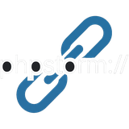

# Php Protocol

<p align="center">
  
</p>

JetBrains IDE plugin that registers **`phpstorm://`** and **`idea://`** URL handlers on **Windows**, so links such as:

```text
phpstorm://open?url=file://%f&line=%l
```

open the file in the **IDE build that owns the project** (nearest `.idea` directory), not a random Toolbox default.

**Plugin ID:** `dev.nowtech.php.protocol`  
**Vendor:** [NOW Tech](https://phpstorm.nowtech.dev)

## Requirements

- PhpStorm / IntelliJ **2026.2+** (build `262.10968+`)
- **Windows** for automatic registry registration (HKCU, no admin)

## What it does

1. Deploys `open-url.js` (+ `json2.js`) to `%USERPROFILE%\.jetbrains\phpstorm-protocol\`
2. Registers `phpstorm` and `idea` under `HKCU\Software\Classes\` to run them via **`wscript.exe`** (no PowerShell console flash)
3. On each opened project, writes `state.json` mapping **project base path → current IDE launcher** (`PathManager.getHomePath()/bin/phpstorm64.exe`, build number, etc.)
4. When a link is clicked, the script walks up from the file path to find `.idea`, picks the matching launcher from `state.json`, and runs:

   ```text
   phpstorm64.exe "<project>" --line <n> "<file>"
   ```

Also supports `phpstorm://open?file=%f&line=%l`.

## Settings

- **Settings → Tools → Php Protocol** — auto-register on startup, manual register, last error
- **Tools → Register phpstorm:// and idea:// handlers…**

## Build

```bash
cp gradle.properties.example gradle.properties
# edit phpstorm.home
./builder build
```

Output: `build/distributions/phpstorm-protocol-*.zip`

## Install

### JetBrains Marketplace

[](https://plugins.jetbrains.com/plugin/35809-php-protocol)

### Install from disk (development build)

**Settings → Plugins → Install Plugin from Disk…** → ZIP → restart IDE.

Open a project once so the plugin can write the project mapping, then test a link from the browser.

## Verify

IDE log:

```text
Php Protocol: scheduling handler registration
Php Protocol: install ok
Php Protocol: registered project "C:\path\to\project" -> PS-262.xxxxx
```

Logger: `dev.nowtech.php.protocol`

Registry (PowerShell):

```powershell
Get-ItemProperty 'HKCU:\Software\Classes\phpstorm\shell\open\command'
```

## macOS / Linux

Automatic registration is **not** implemented yet. Recent JetBrains builds may ship their own handlers; otherwise use the standalone installers linked above.

## License

MIT © [NOW Tech](https://phpstorm.nowtech.dev)
